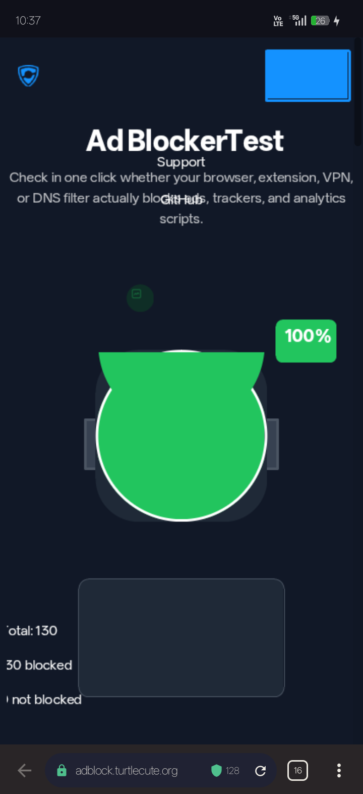

# Nova Android 2.15: Text in Flex Containers Jumped to x=0 on the First Reflow

**Date:** 2026-11-13
**Session:** "tablet is unlocked, continue testing"
**Status:** Code complete and tested offline. **2.15 is not yet checked on the realme tablet:** it went back to sleep before the install (the tablet still has the 2.14 diagnostic build). I do not unlock the screen or approve install prompts.

---

## Summary
With 2.14 installed (see `doc/2026-11-13-nova-android-2.14-flex-flow-shorthand.md`) the ad-block test page on the realme RMX5264 showed its header, heading, gauge and result numbers for the first time, but text in several flex items was drawn in the wrong place: the menu links "Support" and "GitHub" at the screen centre (they belong off-screen to the right), the result rows "Total: 130 / 130 blocked / 0 not blocked" at the far left outside their card, and the labels of the buttons next to their boxes. Another temporary on-device dump showed the boxes of those elements correct; only the text was wrong. The text lives in anonymous wrapper boxes that the incremental layout laid out on their own at x=0 with the full viewport width.



## Root Causes

### 1. Anonymous text wrappers were laid out on their own at x=0, full width, on every incremental reflow
**Files:** `src/browser/rendering/layout-engine.ts` (`layoutNodeIncremental`), with `src/browser/rendering/dom-tree.ts` (`wrapTextRuns`)
**Problem:** after the first reflow, text directly inside a flex or grid container next to an element (`<span><svg/> Total: 130</span>`) was painted at x=0. In an offline replay of the real page at the tablet's size, the painted text positions were `Total:` at x=0 (its span is at x=109) and `blocked` at x=16 and 25; after a forced full relayout the same boxes were at x=117 to 132.
**Root cause:** `wrapTextRuns` wraps each run of text in a container's content in an anonymous item, cached per text node, created with `_dirtyLayout: true`. `clearLayoutDirty` clears the flags of DOM children and generated boxes only, so these wrappers stay dirty forever. `layoutNodeIncremental` walks a clean element's `boxChildren`, found the wrapper dirty, and called `layoutNode(wrapper, x, y, availableWidth)` with the walk's own x (0) and width (the viewport's), overwriting the box and text runs the parent's flex layout had set. A log of the incremental pass showed six wrappers laid out this way in the first reflow with the body clean, e.g. `::anonymous x=0 y=658 w=423 oldbox=117,622,31`.
**Fix:** the clean-node walk skips anonymous wrappers. They are laid out with their parent, which is dirty whenever its content changes.

```ts
if (child.nodeType === 'element' && (child as DomElement).tagName !== '::anonymous') {
  childY = this.layoutNodeIncremental(child as DomElement, x, childY, availableWidth, parentFontSize, domTree, damage);
}
```

After the fix the same log shows only the body's own relayouts.

## Remaining on the realme (2.14 screenshots; not re-checked on 2.15)
- the gauge liquid is not clipped to its circle (it draws as a trapezoid above it; 2.12's rounded clip worked on the emulator);
- the hamburger button is a blue rectangle without its icon (its `svg` box is 24x24 at x=347 in the dump);
- the heading reads "Ad BlockerTest" (a space is lost between words in letter-spaced text on this device);
- the "See the tested setups" button's box and label are offset.

Some of these may be the same cause as #1; I will know when 2.15 is on the tablet.

## Files Modified
| File | Change |
|------|--------|
| `src/browser/rendering/layout-engine.ts` | `layoutNodeIncremental` skips anonymous wrappers (#1) |
| `android/app/build.gradle` | 2.14 (115) to 2.15 (116) |

## Files Created
| File | Purpose |
|------|--------|
| `tests/anonymous-flex-text-reflow-215.test.ts` | text next to an svg in a flex span inside a centred card stays inside the card (x at least 80) after the first incremental frame and after a further reflow; it was at x=0 before the fix (fails with the source reverted) |
| `doc/img/2026-11-13-nova-2.14-ad-block-test-realme.png` | the realme with 2.14 |

## Test Results
```
npx vitest run tests/anonymous-flex-text-reflow-215.test.ts -> 1 passed; with src/ reverted (git apply -R): 1 failed (expected 0 to be >= 80)
npx tsc --noEmit -p .              -> clean
npx vitest run                     -> Test Files 345 passed (345); Tests 11486 passed (11486)
gradlew --no-daemon -q :app:testDebugUnitTest :app:assembleRelease -> exit 0
apksigner verify Nova-2.15.apk     -> verified; versionCode 116, versionName 2.15

realme RMX5264 (Android 16, WebView 156, 423x822 CSS px at 1.7), diagnostic build with 2.14 (temporary code, removed before the commit):
  layout boxes: #adb_test_r 92,629,240,138; its spans 109,646 / 686 / 726 (206x24); nav>ul 439,80 (fixed, right:-100%, off-screen, correct);
                li 600 / 604 / 628; hamburger 309,14 with svg 347,33; .lt_circle 112,363 200x200 -> all consistent: the bug was in painting the text
  offline replay at the same size: Total: painted at x=0 (box x=117), "blocked" at x=16 and 25; after a full relayout x=117..132
  incremental log: ::anonymous x=0 w=423 laid out on their own with the body clean (6 in the first reflow, 9 more later)
  with the fix: no standalone ::anonymous layouts; only body relayouts remain
realme, 2.15: not installed (tablet asleep); not tested
OnePlus Pad / emulator: not used this round
```
